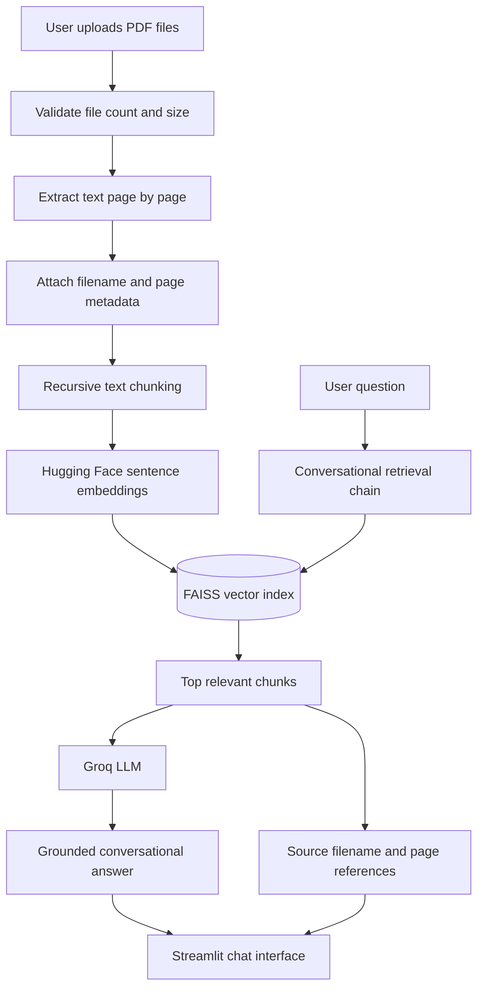

# PDF Research Assistant

A conversational document-question-answering application built with **Streamlit, LangChain, Groq, Hugging Face sentence embeddings, and FAISS**. Upload multiple PDFs, ask questions in natural language, and inspect the source file and page references used by the retrieval pipeline.

## Highlights

- Multi-PDF upload with file-count and per-file size validation
- Page-by-page PDF text extraction with document metadata
- Overlapping text chunks that retain source filename and page number
- Local sentence-transformer embeddings with a cached model
- FAISS semantic retrieval with configurable top-k retrieval
- Conversational question answering powered by Groq
- Source references displayed with each assistant answer
- Chat reset and clear error messages
- Unit tests and GitHub Actions CI

## Architecture



## Technology stack

| Component | Technology | Responsibility |
|---|---|---|
| UI | Streamlit | Uploads, chat, source display |
| PDF parsing | pypdf | Page-level text extraction |
| Chunking | LangChain text splitters | Overlapping document chunks |
| Embeddings | Hugging Face Sentence Transformers | Semantic vector representations |
| Vector store | FAISS | Similarity search |
| Orchestration | LangChain | Retrieval and conversation memory |
| LLM | Groq API | Conversational answer generation |
| Tests / CI | unittest, GitHub Actions | Regression checks |

## Requirements

- Python **3.11**
- A Groq API key
- Internet access for Groq requests and the initial embedding-model download
- Text-based PDFs (OCR for scanned PDFs is not included)

## Quick start

### 1. Clone the repository

```bash
git clone https://github.com/muneerahmedkhokhar53-wq/Chat_with_multiple_PDFs_using_LangChain_Groq_and_Streamlit.git
cd Chat_with_multiple_PDFs_using_LangChain_Groq_and_Streamlit
```

### 2. Create and activate a virtual environment

**Windows PowerShell**

```powershell
py -3.11 -m venv .venv
.\.venv\Scripts\Activate.ps1
```

**macOS / Linux**

```bash
python3.11 -m venv .venv
source .venv/bin/activate
```

### 3. Install dependencies

```bash
python -m pip install --upgrade pip
python -m pip install -r requirements.txt
```

### 4. Configure the Groq API key

Copy the example environment file:

**Windows PowerShell**
```powershell
Copy-Item .env.example .env
```

**macOS / Linux**
```bash
cp .env.example .env
```

Set your key in `.env`:

```dotenv
GROQ_API_KEY=your_groq_api_key
```

Create a key at [Groq Console](https://console.groq.com/). Never commit your real `.env` file or expose API keys in source code, screenshots, or logs.

### 5. Launch the application

```bash
python -m streamlit run app.py
```

Open the local URL printed by Streamlit, upload PDFs in the sidebar, select **Process documents**, and start asking questions.

## Run tests

```bash
python -m unittest discover -s tests -v
```

GitHub Actions runs the same unit-test command on pushes to the main/feature branches and on pull requests targeting `main`.

## Application behavior

1. Each PDF is read page by page.
2. Extracted pages become LangChain documents with filename and 1-based page metadata.
3. A recursive splitter creates overlapping chunks while retaining metadata.
4. Hugging Face embeddings are generated and stored in a FAISS index in memory.
5. A conversational retrieval chain searches the index and sends relevant context to the Groq model.
6. The answer is displayed with deduplicated source filename/page references.

## Current limits

- **Scanned PDFs:** image-only pages need OCR; this version reports when no extractable text is found.
- **Grounding:** citations identify retrieved source pages, but the model can still make mistakes. Always verify important claims in the original document.
- **Persistence:** the FAISS index and conversation are held in the Streamlit session; reprocess documents after a session reset.
- **Scale:** the current implementation is intended for small-to-medium personal document collections, not large multi-user knowledge bases.
- **Provider dependency:** question answering requires the Groq API and is subject to its availability, rate limits, and data-handling terms.
- **Embeddings:** the sentence-transformer model is downloaded on first use and cached by the running app.

## Security and privacy

Uploaded document text is processed locally for extraction and embeddings, but retrieved text is sent to the configured Groq service as context when answering questions. Do not upload confidential, regulated, or third-party documents unless you have permission and have reviewed the provider's data-handling terms. For public deployment, add authentication, stricter resource controls, observability, and a documented retention policy.

## Project structure

```text
.
├── app.py
├── requirements.txt
├── .env.example
├── .python-version
├── tests/
│   └── test_pipeline.py
└── .github/
    └── workflows/
        └── ci.yml
```

## Maintainer

**Muneer Ahmed Khokhar**

Mechatronics Engineering | AI, Machine Learning, Computer Vision & Robotics

---

*Built as a practical exploration of retrieval-augmented generation (RAG) for multi-document question answering.*
